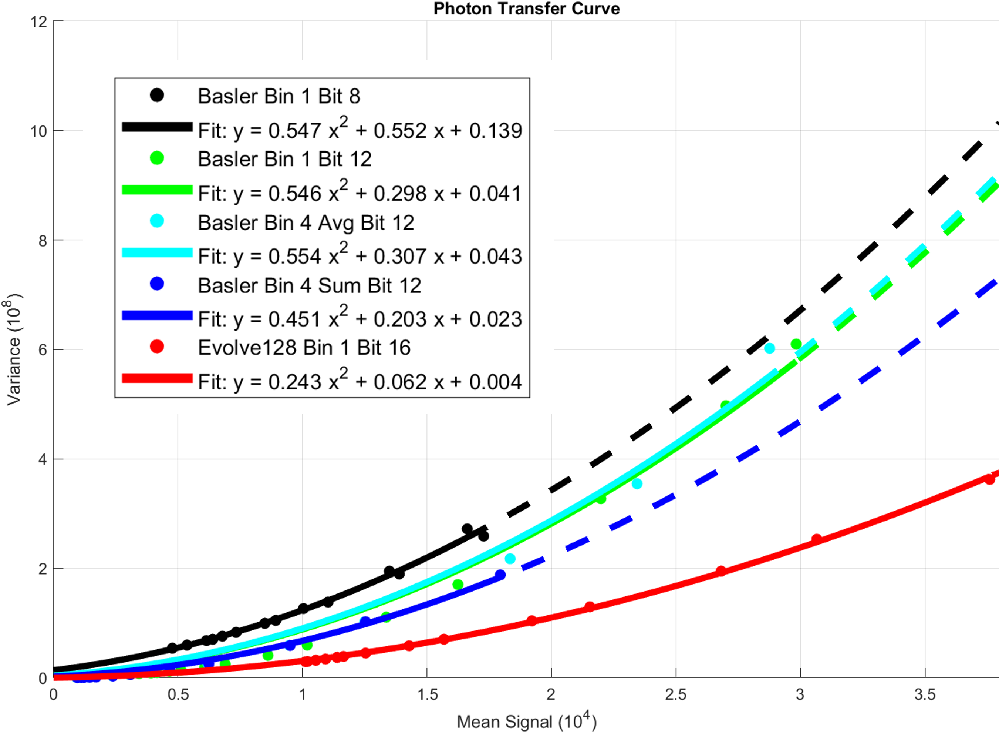
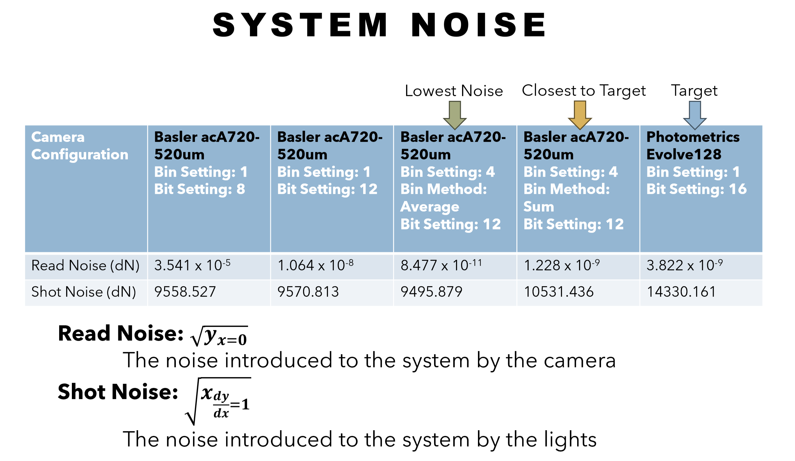

# Keela

Image Aquisition Program, Specializing in Cardiac Optical Mapping

Goal: Making High Quality Cardiac Optical Mapping Experiments Accessible

Makers: 
&nbsp;&nbsp;&nbsp;CHAOS Lab at Georgia Institute of Technology 
&nbsp;&nbsp;&nbsp;Atlanta, GA 
&nbsp;&nbsp;&nbsp;United States 
&nbsp;&nbsp;&nbsp;Authors: Brandon Piña, Henry McIntyre, and Evan Hartley 

## Windows General Instructions

### Installation

Download [Keela](https://github.com/Evan-Hartley/Keela)

Plug camera (one of each camera product type intended to be used) into target computer.

Double-click on `Keela-Setup.exe` to run installer.

### Running Keela

Plug all cameras for experiment into the target computer.

Launch Keela Application from windows start up menu or Desktop shourcut.

### Notes

If you ever need to switch or add a different model of camera, reinstall Keela using `Keela-Setup.exe` or follow the instructions under the "If Camera Driver Error Occurs" section.

Keela may make cameras not plug-and-play compatible with maufactorer software, see more under the "If Camera Driver Error Occurs" section.

## Windows - Independent Installation Instructions

- Install [MSYS2 MinGW](https://www.msys2.org/)
- Add mingw64 bin directory to PATH env variable (by default this will be C:\msys64\mingw64\bin)
- Open a mingw64 terminal via the windows search bar
- Update the terminal using: `$pacman -Syu` (restart and reopen the mingw64 terminal if prompted)
- Install the following dependencies via pacman: `$pacman -S <package-name>`
    - `mingw-w64-x86_64-toolchain`
    - `mingw-w64-x86_64-cmake`
    - `mingw-w64-x86_64-hwloc`
    - `mingw-w64-x86_64-meson`
    - `mingw-w64-x86_64-nsis`
    - `git`
- Run `git clone https://github.com/Evan-Hartley/Keela.git <target-location>`
- Use the `cd "C:\<file-path-from-root>"` command to navigate into the main Keela directory
- Run the following commands in the repository directory using mingw64 terminal
    - `bash build-Keela.sh`
- After the build is complete, navigate to the Keela-Setup.exe file
- Double-click on `Keela-Setup.exe` to run installer
- Now follow instructions from "Windows General Instructions - Running Keela"

# If Camera Driver Error Occurs

Keela is compatible with Aravis compatible cameras (GenICam Camera from manufactures such as Basler, FLIR, and Allied Vision). The `Keela-Setup.exe` detects compatible comeras plugged into the computer upon installation and converts the base drivers of dected camera types to use the `libusbK (v3.1.0.0)` camera driver.

Because of this driver change, manufactorer specific software will not be plug-and-play compatible with the camera (you will need to follow manufactorer instructions for reinstallation of the origional camera driver -- built into most manufactorer programs). Switching between the two programs will require you to reinstall the `libusbK (v3.1.0.0)` camera driver (outlined below) before launching Keela.

Additionally, if after running `Keela-Setup.exe` you encounter a driver error from Keela, this means Keela is having a hard time finding your camera, here's a way around our driver installer:

- Download [Zadig](https://zadig.akeo.ie/)
    - Preferred version as of October 2026: Zadig 2.9
- Plug camera into the target computer
- Follow these steps to select a driver:
    - Select "Options" then "List All Devices"
    - In item drop down menu, select the target Aravis supporting camera
    - Leave the current driver as detected, but change the new driver to `libusbK (v3.1.0.0)`
    - Click the "Install WCID Driver" Button (**Note:** if already installed, this button will instead read "Reinstall Driver")
    - **NOTE:** On the rare occassion that hte installation fails, just run through these steps again

# Camera Program Proceedure
- Plug in camera(s) before program launch
- Launch Keela Application from windows start up menu or Desktop shourcut
- To restart cameras (needed after changing camera settings and some recordings), use the "Restart Cameras" button
- Select a binnning method and scale, then restart cameras to initiate changes (**Crash Alert:** This is the most likely step to crash the program but it saves after being changed even with a program crash, type your scale value into the box for better results and quickly restart the cameras after - Oct 2026)
    - Our testing camera is the [Basler acA720-520um](https://www.baslerweb.com/en/shop/aca720-520um/), we recommend using the Sum Binning Style with a scale of 4 and lower your gain setting to prevent data saturation for this camera
        
        
        
- Adjust gain, exposure, and frequency to desired values, then restart the cameras to initiate changes (Recommended Exposure: $1000-1500 \\mu s$, Recommended Frequency: $500 Hz$)
- Select a bit depth for the gathered data, the restart cameras to initiate changes (**Note:** Check camera data sheet before inputting data aquisition bit depth - the Basler acA720-520um supports up to 12-bit data aquisition, with an 8-bit default) (**Crash Alert:** This is the second most likely step to crash the program, use the +/- buttons for better results and quickly restart the cameras after changing to desired bit depth, this is additonally the only feature that doesn't save upon a crash so if your camera crashes, redo this setup step - Oct 2026)
- Click the "Show Traces" Check Box
    - You can adjust the amount of seconds displayed on the trace feed (recorded data remains unaffected)
    - You can choose to reset the trace feed, so that your trace window clears and reinitalizes itself (recorded data remains unaffected)
    - Within the trace window you can invert the display of the traces as they are displayed to you (recorded data remains unaffected)
    - Within the trace window you can reduce the time resolution of the traces displayed to you (recorded data remains unaffected)
    - Within the trace window you can read the minimum and maximum values of the trace to know the amplutude of your signal in the ROI (or camera feed if no ROI selected)
- Click and drag on the video feed to select a region of interest (ROI) for the trace to average over (**Note:** Original feed with no ROI is an overall average of the image)
- Select a directory (**Note:** You will be prompted to select a directory if you are attempting to record without having previously selected a directory)
- To record data select the "Begin Recording" button, this will then change to say "Recording" while the recording is in progress. To end the recording, select the same button now labeled "Recording".
    - All saved files are time stamped down to the millisecond at the beginning of the recording, so there will be no possibility of data overwrites (unless you're a legend)
    - All saved files are written during the recording process, so if the cameras or program crash in the middle of a recording, no data is lost
    - Files are saved as .mkv files and can be viewed immediately after recording using [VLC Media Player](https://www.videolan.org/vlc/download-windows.html). The metadata of the file will also display the dimensions of the video and the targeted framerate
    - To double check the directory you are recording to, hover over the "Start Recording" button and the selected directoryed path will be displayed
- **Visualization Option:** Providing a Minimum and Maximum in the data visualization window changes the displayed video into a rainbow colored mode, coloring the data within the input range, to help visualize the live data (recorded data remains unaffected)